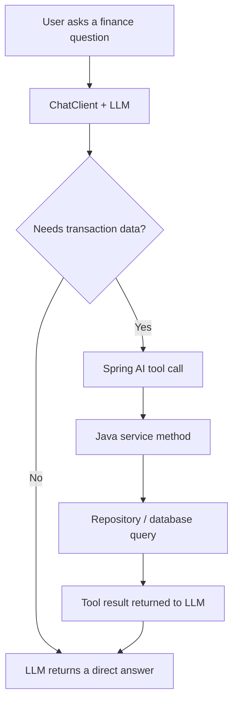

# Tool calling

This note documents how tool calling works in Mint Mate AI.

A **tool** is a Java method that is exposed to the LLM through Spring AI. 

The model does not execute Java code directly. 
Instead, it requests a tool call, Spring AI runs the matching Java method, and the result is passed back to the model for the final answer.

## Flow

## Example

User: “How much did I spend on groceries in October?”

Mint Mate should:
1. Understand the question.
2. Recognize that it needs transaction data.
3. Invoke a Java method to retrieve grocery spending.
4. Receive the result.
5. Explain the answer naturally.

